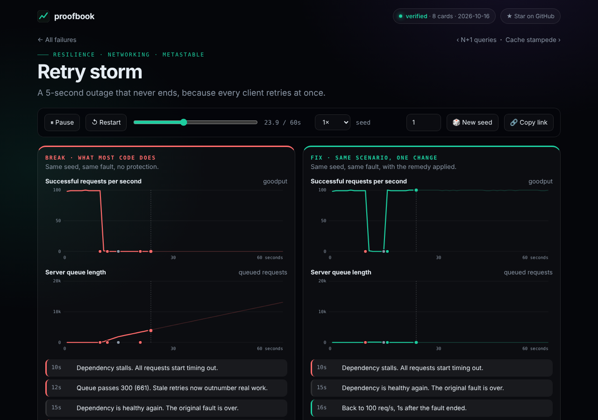

<div align="center">

# proofbook

**Watch software fail. Then watch the fix hold.**

A living atlas of how software breaks in production. Every failure is a deterministic replay you can scrub, re-seed and fix, and CI proves each one still demonstrates what it claims.

[](https://github.com/Khadka1996/random/actions/workflows/ci.yml)




</div>

## See it in 10 seconds

```bash
git clone https://github.com/Khadka1996/random proofbook && cd proofbook
node bin/proofbook.js run retry-storm      # break vs fix, in your terminal
python3 -m http.server 8080                # then open http://localhost:8080 for the visual replay
```

No install step, no dependencies, no Docker. Open `index.html` through any static server, or enable GitHub Pages and it just works.

## The atlas

| Card | The failure in one line | Invariant that breaks |
|---|---|---|
| [`retry-storm`](src/cards/retry-storm.js) | A 5-second outage that never ends because every client retries at once | System recovers after the outage |
| [`cache-stampede`](src/cards/cache-stampede.js) | One hot key expires and hundreds of requests rebuild it together | Unrelated checkout stays healthy |
| [`lost-update`](src/cards/lost-update.js) | Read, add one, write back: increments silently vanish | Every acknowledged increment is stored |
| [`double-charge`](src/cards/double-charge.js) | The reply was lost, the client retried, the customer paid twice | Each order charged exactly once |
| [`clock-skew`](src/cards/clock-skew.js) | Last-write-wins trusts a clock that is 3 seconds slow | The newest real write wins |
| [`unbounded-queue`](src/cards/unbounded-queue.js) | Producers outrun the consumer and every wait grows forever | No message waits over 5s |
| [`poison-message`](src/cards/poison-message.js) | One bad message blocks everything queued behind it | All healthy messages processed |
| [`n-plus-one`](src/cards/n-plus-one.js) | One query per row: fast at 5 rows, painful at 500 | Page stays under 100ms |

Each card gives you: **why it happens**, **how to spot it in production**, **the fix**, and a replay of both.

## Why this is different

Most failure collections are lists of links. Proofbook is built on one idea: **a failure you can replay is a failure you understand.**

- **Deterministic.** A virtual clock and a seeded random generator mean the same seed gives the same trace, byte for byte, in Node and in the browser. No flaky demos.
- **Instant.** Models run in milliseconds, so the replay needs no server, no containers and no install.
- **Proven.** Every card declares an *invariant*. CI asserts the failure **violates** it and the fix **holds** it, across five seeds, and checks that two runs produce an identical trace. A card that stops proving its point fails the build.
- **Honest.** These are models of failure mechanisms, not measurements of production. The mechanism and the remedy are real; exact numbers are illustrative. The site says so.

```
                ┌────────────────────────────────────────────┐
 card.run() ──▶ │ Sim: virtual clock · seeded PRNG · events  │ ──▶ { series, events, invariant }
                └────────────────────────────────────────────┘          │
                                                  ┌─────────────────────┼─────────────────────┐
                                                  ▼                     ▼                     ▼
                                           browser replay          CLI sparklines       CI verification
                                           (index.html)        (bin/proofbook.js)      (npm test, verify)
```

## Add a card in 15 minutes

1. Copy [`templates/new-card.js`](templates/new-card.js) to `src/cards/<your-failure>.js`.
2. Model the failure with `Sim` (about 40 lines): `variant === 'fix'` flips on the remedy.
3. Return the series to chart, the events worth narrating, and one invariant.
4. Add it to [`src/cards/index.js`](src/cards/index.js).
5. Run `npm test`. If the break violates and the fix holds, you are done.

Need an idea? [`docs/card-ideas.md`](docs/card-ideas.md) lists 30 failures waiting to be written. See [CONTRIBUTING.md](CONTRIBUTING.md).

## Commands

```bash
node bin/proofbook.js list                     # all cards
node bin/proofbook.js run <card>               # break then fix
node bin/proofbook.js run <card> --fix --seed 7
node bin/proofbook.js verify                   # prove every card, write verified.json
npm test                                       # 34 tests: determinism, break violates, fix holds
```

## Roadmap

- [x] Engine, 8 cards, CLI, visual replay, CI
- [ ] 30 more cards ([`docs/card-ideas.md`](docs/card-ideas.md))
- [ ] "Interview mode": guess the bug from the graphs, then reveal
- [ ] Real-runtime reproductions (Go, Java, Python) linked from each card
- [ ] Shareable per-card images for social posts
- [ ] Search and filter by tag on the site

## License

MIT. Fork it, extend it, teach with it.

<div align="center">

If a card taught you something, a ⭐ helps others find it.

</div>
